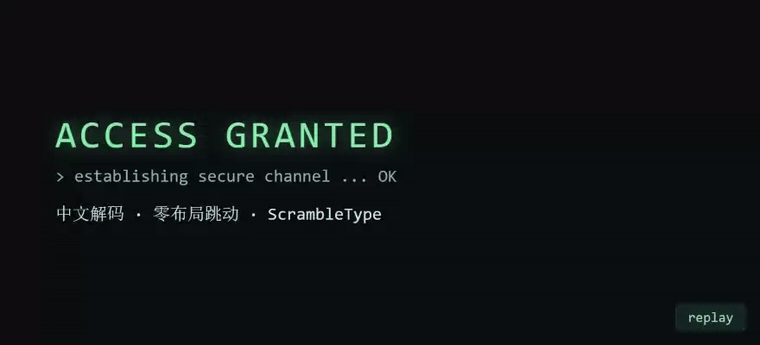
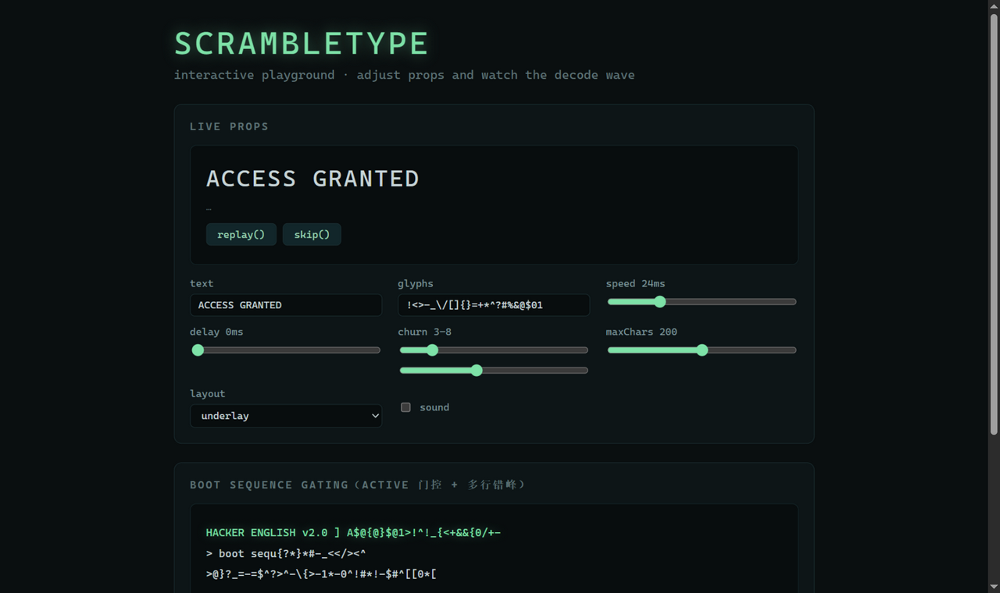
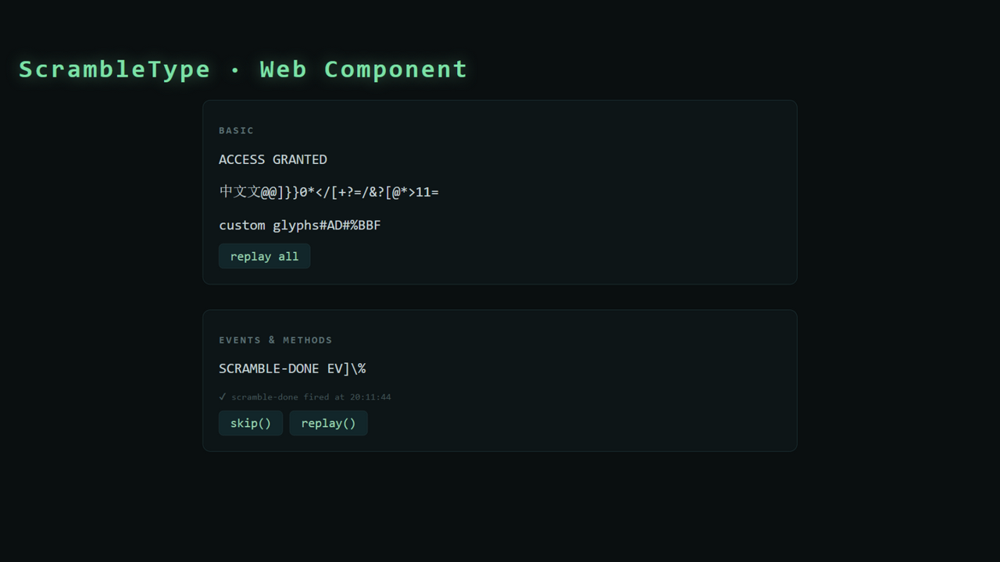

<div align="center">

# ScrambleType

**零依赖的乱码解码打字机文字特效，支持 React、Vue 与纯 HTML。**

`npm install scramble-type`

[](https://www.npmjs.com/package/scramble-type)
[](./LICENSE)

[English](./README.md)

</div>

---

文本从左到右依序"落定"，每个字符落定前以随机乱码符号跳动——有质感的"解码波"，为终端 / 黑客风 / 科幻 UI 而生。

<div align="center">
  
</div>

```tsx
import { ScrambleText } from "scramble-type";

<ScrambleText text="ACCESS GRANTED" speed={24} />;
```

## 特性

- **零运行时依赖** — React 入口 brotli 后 < 2 kB，核心引擎约 0.7 kB。
- **一个包覆盖所有技术栈** — React（默认入口）、Vue 3、Web Component、框架无关 core 引擎。
- **零布局跳动** — 默认 `underlay` 布局，任意字体（含中文与比例字体）宽度稳定。
- **SSR 安全 & 可访问** — 服务端直出最终文本；读屏器读为完整一句（`aria-label`）；尊重 `prefers-reduced-motion`。
- **可控制** — `onDone` / `onTick` 回调；ref 暴露 `replay()` / `skip()`；`delay` 实现多行错峰。
- **可选打字音** — WebAudio 纯合成，无音频资源、无配置文件。
- **类型完整** — 全量 TypeScript 类型。

## 截图预览

| React playground（实时调参） | 纯 HTML · Web Component |
| --- | --- |
|  |  |

## 安装

```bash
npm install scramble-type   # 或 pnpm / yarn / bun add
```

按技术栈选择入口：

| 技术栈 | 引入方式 |
| --- | --- |
| React / Next.js / Remix | `import { ScrambleText } from "scramble-type"` |
| Vue 3 / Nuxt | `import { ScrambleText } from "scramble-type/vue"` |
| 任意框架 / 自行封装 | `import { createScramble } from "scramble-type/core"` |
| Web Component | `import "scramble-type/wc"` |
| 纯 HTML（CDN） | `<script src="https://cdn.jsdelivr.net/npm/scramble-type/dist/wc/global.js"></script>` |
| 打字音（可选） | `import { createTickSound } from "scramble-type/sound"` |

### React

```tsx
import { ScrambleText } from "scramble-type";

// 标题解码
<ScrambleText text="ACCESS GRANTED" speed={24} onDone={() => console.log("done")} />

// 多行错峰
{lines.map((line, i) => (
  <ScrambleText key={line} text={line} delay={i * 150} speed={20} />
))}

// 阶段门控（active=false 时渲染占位空白，保留宽度）
<ScrambleText text="BOOTING…" active={stage >= 2} />

// 命令式控制
const ref = useRef<ScrambleTextRef>(null);
<ScrambleText ref={ref} text="REPLAY ME" />;
ref.current?.replay();
ref.current?.skip();
```

### Vue 3

```vue
<script setup>
import { ScrambleText } from "scramble-type/vue";
</script>

<template>
  <ScrambleText text="ACCESS GRANTED" :speed="24" @done="onDone" />
</template>
```

### 纯 HTML（无构建）

```html
<script src="https://cdn.jsdelivr.net/npm/scramble-type/dist/wc/global.js"></script>

<scramble-text text="ACCESS GRANTED" speed="24"></scramble-text>
<scramble-text text="中文解码 · 零布局跳动" speed="22" delay="400"></scramble-text>

<script>
  document.querySelector("scramble-text").addEventListener("scramble-done", () => {
    console.log("解码完成");
  });
</script>
```

### 框架无关 core

```ts
import { createScramble } from "scramble-type/core";

const handle = createScramble({
  onFrame: (text) => (el.textContent = text),
  onTick: () => tickSound(),
  onDone: () => console.log("decoded"),
});
handle.start("ACCESS GRANTED", { speed: 24, churn: [3, 8] });
```

### 可选打字音

```tsx
import { ScrambleText } from "scramble-type";
import { createTickSound } from "scramble-type/sound";

// 接自己的音频管线……
<ScrambleText text="…" onTick={createTickSound({ volume: 0.07 })} />

// ……或用便捷写法（内置合成音）
<ScrambleText text="…" sound />
```

## API

### `<ScrambleText />`（React / Vue，同名同默认值）

| Prop | 类型 | 默认值 | 说明 |
| --- | --- | --- | --- |
| `text` | `string` | — | 目标文本（必填） |
| `speed` | `number` | `34` | 每 tick 间隔（ms），越小越快 |
| `delay` | `number` | `0` | 启动延迟（ms），多行错峰用 |
| `churn` | `[number, number]` | `[3, 8]` | 每字符落定前的乱码跳动帧数区间 |
| `glyphs` | `string` | `"!<>-_\\/[]{}=+*^?#%&@$01"` | 乱码字符池 |
| `maxChars` | `number` | `200` | 超长直出阈值；`0` 表示关闭动画 |
| `maxDuration` | `number` | `1600` | 自适应提速的总解码时长上限（ms） |
| `active` | `boolean` | `true` | `false` 渲染动画前占位状态（空白但保留宽度） |
| `layout` | `"underlay" \| "nbsp" \| "none"` | `"underlay"` | 宽度稳定策略（见下） |
| `respectReducedMotion` | `boolean` | `true` | 系统"减弱动态效果"时直出最终文本 |
| `sound` | `boolean` | `false` | 播放内置合成打字音 |
| `className` / `style` / `as` | — | `"span"` | 宿主元素透传（`as` 指定标签） |
| `onTick` | `() => void` | — | 每帧触发 |
| `onDone` | `() => void` | — | 解码完成触发一次 |

**布局策略**

- `underlay`（默认）— 真实文本隐藏打底，乱码层绝对定位覆盖。任意字体零宽度跳动，包括比例字体下的中文。
- `nbsp` — 等量 NBSP 占位（最轻量，适合等宽字体）。
- `none` — 不占位。

**ref 方法**（React `ref` / Vue `expose`）：`replay()`、`skip()`。

### `scramble-type/core`

```ts
createScramble(handlers, defaults?) → ScrambleHandle
handle.start(text, options?)  // 开始 / 换文本重启
handle.skip()                 // 立即落定为最终文本
handle.stop()                 // 停在当前帧
handle.dispose()              // 释放定时器
handle.isDone                 // 是否已完成
resolveSpeed(charCount, speed?, maxDuration?)  // 自适应提速规则（已导出，可复用）
prefersReducedMotion()        // SSR 安全的媒体查询助手
```

### `<scramble-text>`（Web Component）

| 属性 | 示例 | 说明 |
| --- | --- | --- |
| `text` | `text="ACCESS GRANTED"` | 目标文本 |
| `speed` / `delay` / `max-chars` / `max-duration` | `speed="24"` | 数字以字符串传入 |
| `churn` | `churn="3,8"` | 两个数字，逗号分隔 |
| `glyphs` | `glyphs="ABCDEF#%"` | 乱码字符池 |
| `active` / `sound` | `active="false"` | `"true"` / `"false"` |

事件：`scramble-tick`、`scramble-done`（冒泡）。方法：`replay()`、`skip()`。

## 说明与局限

- **SSR** — 服务端直出最终文本，动画在 hydration 后才开始（无闪烁、无 hydration 告警）。React 入口带 `"use client"`，Next.js App Router 直接可用。
- **可访问性** — 宿主元素 `aria-label={text}`，动画层 `aria-hidden`，读屏器只读最终文本。`prefers-reduced-motion: reduce` 时默认静态直出。
- **中文** — 完整支持；`underlay` 布局在比例字体下也能保持宽度稳定。
- **Emoji / ZWJ 组合序列** — 组合 emoji 可能被拆散成乱码块（按 Unicode 码点迭代）。此类文本建议静态直出（`maxChars={0}`）。
- **后台标签页** — 浏览器对 `setInterval` 降频，动画自动暂停、回前台续播，最终态始终正确。
- **浏览器** — 常青浏览器（ES2020），不带 polyfill。

## 开源协议

[MIT](./LICENSE) © ScrambleType Authors

本项目以 **MIT 协议**开源——可免费商用、修改、再分发，唯一要求是保留版权声明。MIT 是 JS UI 库的事实标准：采用门槛最低（闭源产品也能放心使用），且与几乎所有其他协议兼容。

## 本地开发

```bash
npm install
npm test          # 48 个单测
npm run dev       # 交互 playground（http://localhost:5173）
npm run build     # 构建五入口 + 类型
npm run docs:dev  # 文档站
```
